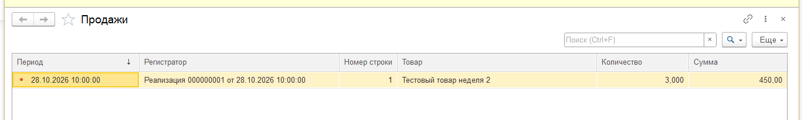
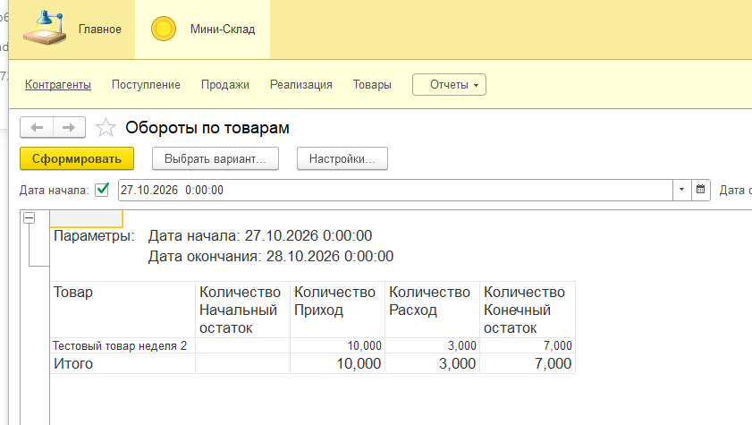
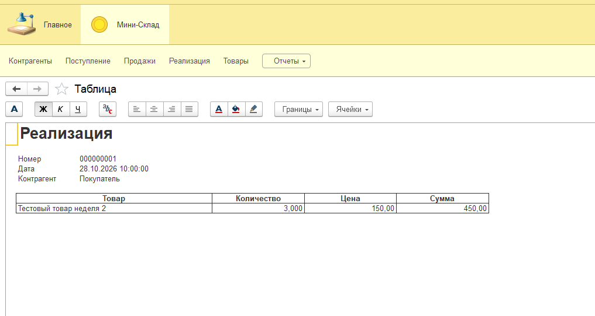

# Отчёт по лабораторной работе

**ФИО:** Мельников Руслан Дмиориевич

**Неделя / Лаба:** неделя 2 — регистры, СКД, печатная форма и подготовка к интеграции «Меркурий».

**Дата:** 1 ноября 2026 года.

**Цель работы:** дополнить учебную конфигурацию «Мини-Склад» оборотным
регистром, отчётом на СКД и печатной формой реализации. Разобрать порядок
установки и настройки интеграции кб99 с ФГИС «Меркурий».

**Среда:** Windows, «1С:Предприятие» 8.5.1.1150, учебная версия,
файловая информационная база, режим совместимости 8.5.1.

**Репозиторий:** [ygwhite/kb99-1c-mini-sklad-2-week](https://github.com/ygwhite/kb99-1c-mini-sklad-2-week).

## Шаги воспроизведения

1. Создать пустую файловую базу и загрузить конфигурацию первой недели
   из XML-файлов. В ней уже были справочники `Товары`, `Контрагенты`,
   документы `Поступление`, `Реализация` и регистр `ОстаткиТоваров`
   с приходными и расходными движениями.
2. Добавить регистр накопления `Продажи` вида «Обороты»: измерение `Товар`
   типа `СправочникСсылка.Товары`, ресурсы `Количество` — число 15.3
   и `Сумма` — число 15.2. Включить регистр в подсистему «Мини-Склад»
   и назначить `Реализацию` регистратором.
3. Дополнить проведение реализации. По каждой строке записать расход
   в `ОстаткиТоваров` и количество/выручку в `Продажи`.
   Выручка равна произведению количества на цену.
4. Создать отчёт `ОборотыПоТоварам` на СКД. Источник — виртуальная таблица
   `ОстаткиТоваров.ОстаткиИОбороты`; группировка — `Товар`.
   Вывести начальный остаток, приход, расход и конечный остаток.
   Конец расчётного периода вычислять выражением
   `КонецПериода(&ДатаОкончания, "День")`.
5. Создать и провести приведённые ниже документы по одному товару.
   Сформировать отчёт за 27–28 и 27–29 октября.
6. Конструктором печати создать команду и макет `Печать` реализации
   для управляемых форм. В шапку включить номер, дату и контрагента;
   в таблицу — товар, количество, цену и сумму. Сформировать печатную форму.
7. Выгрузить конфигурацию в XML. Загрузить её в отдельную пустую базу,
   обновить структуру и проверить конфигурацию для тонкого клиента
   и сервера. Результат проверки — «Ошибок не обнаружено».

### Подготовка к интеграции Меркурий

По [инструкции установки кб99](https://docs.kb99.pro/s/vetis-for-1cv8/doc/ustanovka-v-1s-predpriyatie-83-QOnGyD9U0f)
модуль добавляется как подсистема. Порядок установки:

1. Получить файл интеграции, создать резервную копию и работать в копии базы.
2. Разрешить необходимые изменения в настройках поддержки.
3. Выполнить сравнение и объединение с конфигурацией из файла интеграции.
4. Выбрать по подсистемам файла объекты `кб99_ВСД`; при необходимости
   включить модуль переопределений и требуемые расширения.
5. Завершить объединение, обновить конфигурацию базы данных и проверить запуск.

В [документации по параметрам](https://docs.kb99.pro/s/vetis-for-1cv8/doc/nastrojka-parametrov-5D7Abpk2Wa)
настройки открываются через «кб99 ВСД → Параметры интеграции».
Предусмотрены вкладки подключения, параметров по умолчанию, документов,
производства, инициализации и сервиса. Для обмена требуется заполнить
параметры выбранного контура и реквизиты доступа.

Задача со звёздочкой — установка в отдельную демобазу УТ 11.5 —
не выполнялась. Параметры подключения не заполнялись,
соединение с ВетИС.API и реальный обмен не проверялись.
Для продолжения нужны демобаза УТ 11.5, файл интеграции, проверка
совместимости релизов и учебные реквизиты выбранного контура.

## Что должно получиться

Использован товар «Тестовый товар неделя 2», контрагенты «Поставщик»
и «Покупатель».

| Документ | Дата и время | Количество | Цена | Сумма |
| --- | --- | ---: | ---: | ---: |
| Поступление | 27.10.2026 10:00 | 10 | 100 | 1000 |
| Реализация | 28.10.2026 10:00 | 3 | 150 | 450 |
| Поступление | 29.10.2026 10:00 | 5 | 120 | 600 |

| Проверка | Ожидаемый результат | Полученный результат |
| --- | --- | --- |
| Регистр `Продажи` | Количество 3, сумма 450 | 3 / 450, скриншот 1 |
| Отчёт за 27–28 октября | Начало 0, приход 10, расход 3, конец 7 | 0 / 10 / 3 / 7, скриншот 2 |
| Отчёт за 27–29 октября | Начало 0, приход 15, расход 3, конец 12 | После проведения второго поступления подтверждён остаток 12 |
| Печатная форма | Покупатель, количество 3, цена 150, сумма 450 | Форма сформирована на экране, скриншот 3 |
| Восстановление выгрузки | Загрузка в пустую базу и проверка без ошибок | Проверка 1С завершена без ошибок |

### Скрин 1 Продажи

Одна запись по реализации от 28 октября: количество 3, сумма 450,
товар и регистратор заполнены.

### Скрин 2 Остаток на 28 октября

В отчёте виден период. Поступление от 29 октября не включено в остаток
на 28 октября. Пустая ячейка начального остатка означает ноль.

### Скрин 3 Печатная форма реализации

Сформированы номер, дата, покупатель и строка товара с количеством 3,
ценой 150 и суммой 450.

## Замеченные ошибки/ограничения

- При первом формировании отчёта до 29 октября сохранялся остаток 7.
  После проверки и проведения второго поступления итог стал 12.
- Учебная платформа ограничивает печать и сохранение табличных документов
  в режиме «1С:Предприятие». Проверено формирование на экране;
  физическая печать не проверялась.
- В текущей выгрузке не настроены проверки обязательного заполнения
  контрагента и строк товаров, положительного количества и наличия
  остатка перед продажей. Пункт DoD о проверках данных требует доработки.
- Фактический результат перепроведения и отмены проведения отдельно
  не зафиксирован; сценарии приведены в README для проверки.
- Установка интеграции в демо УТ и обмен с «Меркурием» не выполнялись.

## Вывод (коротко)

Конфигурация развёрнута на Windows и дополнена оборотным регистром,
СКД-отчётом и печатной формой. На тестовых документах получены продажи
3 / 450 и остатки 7 на 28 октября и 12 на 29 октября.
XML-выгрузка загружается в пустую базу и проходит проверку платформы.
Для полного выполнения общих критериев остаются проверки данных;
физическая печать ограничена учебной версией. По интеграции подготовлен
порядок установки и настройки, задача со звёздочкой не выполнялась.
